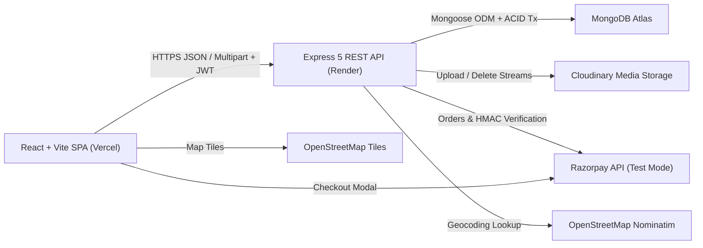
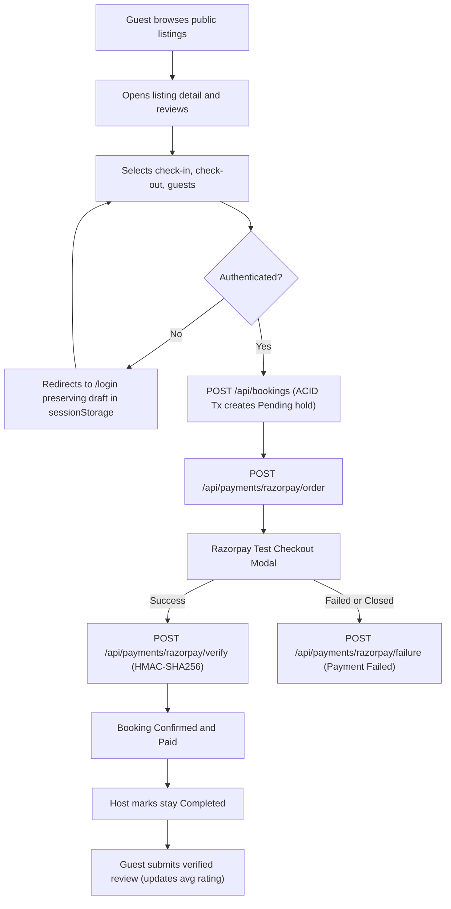
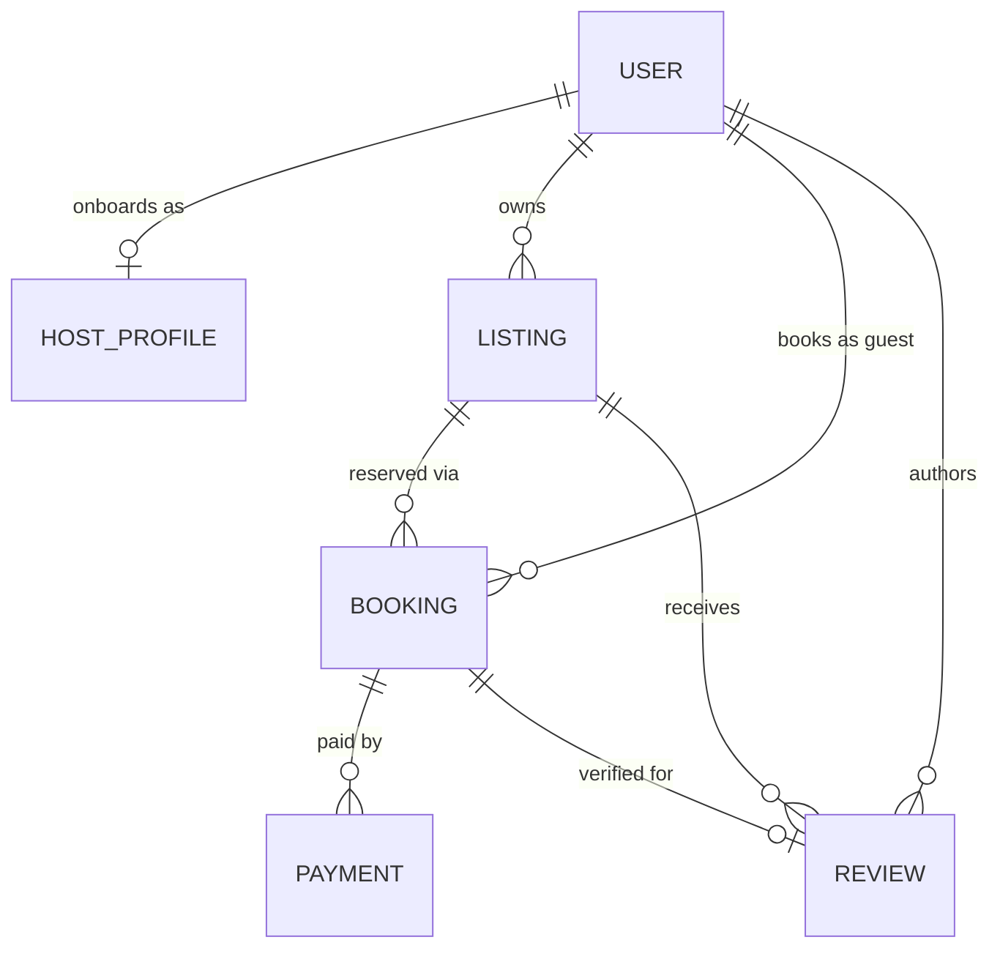

# Livora

> **Full-Stack Rental Booking Marketplace** — Discover unique stays, book date-validated reservations with real-time pricing, pay securely via Razorpay, and manage hosted properties with isolated role-based dashboards.


Livora solves the end-to-end coordination problem between travelers and independent property hosts: public guests can freely discover stays and inspect verified reviews without forced sign-in walls, customers get concurrency-safe reservations with transparent tax/fee breakdowns and cryptographically verified payments, and hosts operate in a strictly isolated dashboard for listings, multi-image galleries, and availability management.

---

## Table of Contents

- [Project Overview](#project-overview)
- [Key Features](#key-features)
- [Screenshots / Demo](#screenshots--demo)
- [Technology Stack](#technology-stack)
- [System Architecture](#system-architecture)
- [Project Structure](#project-structure)
- [Installation and Setup](#installation-and-setup)
- [Environment Variables](#environment-variables)
- [Application Workflow](#application-workflow)
- [API Documentation](#api-documentation)
- [Database Design](#database-design)
- [Security](#security)
- [Testing](#testing)
- [Future Improvements](#future-improvements)
- [Contributing](#contributing)
- [License](#license)
- [Author / Contact](#author--contact)

---

## Project Overview

Livora is built as a decoupled client-server rental marketplace modeled after modern short-term stay platforms:

- **Public Guests** can browse published properties, filter by category, search destinations, inspect multi-image galleries, explore property locations on interactive maps, and read customer reviews without creating an account.
- **Customers** authenticate only when reserving a stay or managing trips, receiving instant server-validated quotes, 15-minute checkout holds backed by MongoDB ACID transactions, Razorpay Checkout integration, trip cancellation/refund tracking, and verified-stay review submission.
- **Hosts** onboard through a dedicated profile workflow without losing their customer booking abilities, gaining an isolated Host Dashboard to publish/unpublish listings, upload up to 8 images per listing via Cloudinary, block/unblock availability dates, view guest reservations, mark paid stays completed, and monitor property reviews.

---

## Key Features

### Public Browsing & Discovery
- **Unauthenticated Browsing**: Public access to `/` and `/listings` and property details (`/listings/:id`), exposing only safe public host metadata (`username` and join date, never private emails or phone numbers).
- **Search, Categories & Tax Toggle**: Case-insensitive search across title, location, country, and description; 10 curated categories (`Trending`, `Iconic Cities`, `Mountains`, `Castles`, `Amazing pools`, `Camping`, `Farms`, `Arctic`, `Domes`, `Boats`); and an interactive `+18% GST` price toggle.
- **Interactive Maps**: Automatic OpenStreetMap Nominatim geocoding on listing create/location edit rendered via Leaflet maps.

### Role-Based Experience (Guest, Customer & Host)
- **Unified Account Model**: Users retain full customer capabilities after becoming a host (`User.isHost` linked 1-to-1 with `HostProfile`).
- **Host Onboarding**: Collects and validates `fullName`, `email`, `phone`, `contactDetails`, and `bio` via `/become-a-host` before unlocking host APIs and routes.
- **Isolated Host Dashboard (`/host/dashboard`)**: Tabbed workspace for **My Listings** (visibility status switching between `published`, `unpublished`, `inactive`), **Availability** (add/remove non-overlapping blocked date ranges), **Bookings** (view reservations & mark confirmed paid stays `Completed`), **Reviews**, and **Host Profile**.

### Bookings, Payments & Verified Reviews
- **Dynamic Pricing & Conflict Protection**: Server-authoritative UTC date checks, guest capacity enforcement, itemized breakdown (`baseAmount`, `cleaningFee`, `12% serviceFee`, `18% GST`), and MongoDB `session.withTransaction` conflict detection with 15-minute `Pending` holds.
- **Razorpay Test Mode Integration**: Creates Razorpay orders in INR (`paise`), verifies callbacks via constant-time HMAC-SHA256 signature comparison, and manages `Pending`, `Confirmed`, `Payment Failed`, `Cancelled` (`Refunded`), and `Completed` states.
- **Customer Bookings Dashboard (`/my-bookings`)**: Displays reservation history, payment status, **Pay with Razorpay** retry for unpaid holds, **Cancel Booking**, and **Write a Review** prompts on completed stays.
- **Verified Stay Reviews**: Backend enforces that only guests with an unreviewed `Completed` + `Paid` booking for that property can submit a rating (1–5 stars), automatically recalculating `Listing.averageRating` and `Listing.reviewCount`.

---

## Screenshots / Demo

- **Live Frontend (Vercel)**: `https://livoraa-sagar.vercel.app`
- **Live Backend API (Render)**: `https://livora-backend-wa1b.onrender.com/api/health` *(Free tier spins down when idle and may take ~30–50s on cold start)*

> **Screenshots (TODO — add captured UI images to the repository before linking):**
> - `[Screenshot Placeholder: Public Explore Grid & Category Filters]`
> - `[Screenshot Placeholder: Property Detail Gallery, Leaflet Map & Booking Card]`
> - `[Screenshot Placeholder: Razorpay Test Mode Checkout & My Bookings Dashboard]`
> - `[Screenshot Placeholder: Host Dashboard — Listings, Availability & Bookings]`

---

## Technology Stack

| Layer | Technologies | Purpose |
| :--- | :--- | :--- |
| **Frontend** | React `19.1`, Vite `6.3`, React Router `7.6` | SPA architecture, client-side routing, protected & host route guards |
| **UI & Maps** | Bootstrap `5.3`, Font Awesome `7.0`, Leaflet `1.9` | Responsive layout, icons, and interactive OpenStreetMap markers |
| **HTTP Client** | Axios `1.13` | API communication with Bearer token & `withCredentials` support |
| **Backend** | Node.js (`>=20`), Express `5.2` | RESTful API server, middleware pipeline, error handling |
| **Database** | MongoDB Atlas, Mongoose `9.0` | Document persistence, indexing, ACID transactions |
| **Auth & Validation** | Passport (`passport-local-mongoose`), `jsonwebtoken`, `cookie-parser`, Joi `18.0` | PBKDF2 password hashing, JWT auth (`httpOnly` cookie + Bearer), strict schema validation |
| **Media & Geo** | Multer `2.0`, Cloudinary `2.8`, OpenStreetMap Nominatim | In-memory multipart parsing, cloud image hosting/cleanup, address geocoding |
| **Payments** | Razorpay Node SDK `2.9` & Razorpay Checkout | Order creation, checkout modal, HMAC-SHA256 payment verification |
| **Testing** | Node.js Test Runner (`node --test`), `node:assert/strict` | Automated end-to-end integration & security test suite |

---

## System Architecture



- **Decoupled Deployment**: The frontend (`frontend/`) builds to static assets served via Vercel with SPA routing ([frontend/vercel.json](file:///c:/Users/sagar/OneDrive/Desktop/4semester/Livora/frontend/vercel.json)), while the backend (`backend/`) runs independently on Render and restricts cross-origin requests via `CLIENT_URL` CORS allowlisting.
- **Dev Proxy**: During local development, [frontend/vite.config.js](file:///c:/Users/sagar/OneDrive/Desktop/4semester/Livora/frontend/vite.config.js) proxies `/api/*` requests directly to `http://localhost:5000`.

---

## Project Structure

```text
Livora/
├── .gitignore
├── package.json                      # Root convenience scripts (dev, build, seed)
├── README.md
├── backend/
│   ├── .env.example                  # Backend environment variable template
│   ├── .gitignore
│   ├── app.js                        # Express app, CORS, security headers, routes, error handler
│   ├── package.json
│   ├── server.js                     # DB bootstrap and HTTP listener (default port 5000)
│   ├── config/
│   │   ├── cloudinary.js             # Multer memoryStorage & Cloudinary upload/delete helpers
│   │   ├── db.js                     # MongoDB Atlas connector with Windows SRV DNS fallback
│   │   └── razorpay.js               # Razorpay client & constant-time HMAC-SHA256 verifier
│   ├── controllers/
│   │   ├── auth.js                   # Signup, login, logout, current user
│   │   ├── bookings.js               # Availability, quote, transactional create, list & cancel
│   │   ├── hosts.js                  # Onboarding, profile, isolated listings/blocks/reviews/bookings
│   │   ├── listings.js               # Public index/show & host CRUD with multi-image handling
│   │   ├── payments.js               # Razorpay order creation, verification, failure recording
│   │   └── reviews.js                # Eligibility check, verified review creation/deletion, rating sync
│   ├── init/
│   │   ├── data.js                   # Sample property seed dataset
│   │   └── index.js                  # Database seeding script (creates demo host & listings)
│   ├── middleware/
│   │   ├── auth.js                   # optionalAuth, requireAuth, requireHost, isOwner, isReviewAuthor
│   │   └── validate.js               # Joi middleware factory & multipart array normalizer
│   ├── models/
│   │   ├── booking.js                # Booking schema & status/payment enums
│   │   ├── hostProfile.js            # 1-to-1 HostProfile schema
│   │   ├── listing.js                # Listing schema, categories, property types, blockedDates
│   │   ├── payment.js                # Payment transaction schema
│   │   ├── review.js                 # Review schema with unique sparse booking index
│   │   └── user.js                   # User schema with passport-local-mongoose & isHost flag
│   ├── routes/
│   │   ├── auth.js
│   │   ├── bookings.js
│   │   ├── hosts.js
│   │   ├── listings.js
│   │   ├── payments.js
│   │   └── reviews.js
│   ├── tests/
│   │   └── marketplace.test.js       # End-to-end integration & security test suite
│   └── utils/
│       ├── bookingPricing.js         # UTC date normalization, pricing math, overlap queries
│       ├── expressError.js           # Custom HTTP error class
│       ├── geocode.js                # Nominatim geocoding with [0, 0] fallback
│       ├── validation.js             # Joi validation schemas
│       └── wrapAsync.js              # Async route error wrapper
└── frontend/
    ├── .env.example                  # Frontend environment variable template
    ├── .gitignore
    ├── index.html
    ├── package.json
    ├── vercel.json                   # Vercel SPA rewrite rules for React Router
    ├── vite.config.js                # Vite config & /api dev proxy to port 5000
    └── src/
        ├── App.jsx                   # Route definitions & access guards
        ├── main.jsx                  # Bootstrap, Font Awesome, Leaflet CSS & providers
        ├── api/
        │   └── client.js             # Axios instance, Bearer token interceptor, error helper
        ├── components/
        │   ├── BookingCard.jsx       # Interactive date/guest picker, live quote & Razorpay checkout
        │   ├── FlashBanner.jsx       # Dismissible notification alerts
        │   ├── Footer.jsx
        │   ├── HostRoute.jsx         # Guards host-only routes
        │   ├── ListingCard.jsx       # Property summary card
        │   ├── ListingForm.jsx       # Shared create/edit form with multi-image preview & amenities
        │   ├── ListingMap.jsx        # Leaflet map with custom marker
        │   ├── Navbar.jsx            # Responsive navigation, search bar & role-aware links
        │   ├── ProtectedRoute.jsx    # Guards authenticated routes
        │   └── StarRating.jsx        # Interactive & read-only star rating UI
        ├── constants/
        │   └── categories.js         # Categories, property types, listing statuses, amenities
        ├── context/
        │   ├── AuthContext.jsx       # User session & refreshUser helper
        │   └── FlashContext.jsx      # Global success/error notification state
        ├── pages/
        │   ├── BecomeHostPage.jsx    # Host onboarding form
        │   ├── CreateListingPage.jsx
        │   ├── EditListingPage.jsx
        │   ├── HostDashboardPage.jsx # Tabbed host management console
        │   ├── ListingDetailPage.jsx # Gallery, specs, BookingCard, verified reviews, map
        │   ├── ListingsPage.jsx      # Public browse grid, filters & GST toggle
        │   ├── LoginPage.jsx
        │   ├── MyBookingsPage.jsx    # Customer trips, payment retry, cancel & review links
        │   ├── SignupPage.jsx
        │   └── StaticInfoPage.jsx    # Privacy, Terms & 404 views
        ├── styles/
        │   └── app.css
        └── utils/
            ├── bookingPricing.js     # Client-side quote & overlap helpers
            └── razorpay.js           # Dynamic Razorpay Checkout script loader
```

---

## Installation and Setup

### Prerequisites
- **Node.js** `>= 20.0.0` (verified with Node `v24.15.0`) and **npm**
- A **MongoDB Atlas** cluster (with database user and IP Access List configured)
- A **Cloudinary** account (for listing image uploads)
- A **Razorpay** account in **Test Mode** (for checkout & signature verification)

### 1. Clone the Repository
```bash
git clone https://github.com/sagarkumarpatel/Livora.git
cd Livora
```

### 2. Install Dependencies
Install backend and frontend packages separately:
```bash
cd backend && npm install
cd ../frontend && npm install
cd ..
```

### 3. Configure Environment Variables
Create `backend/.env` from `backend/.env.example`:
```bash
cp backend/.env.example backend/.env
```
Populate `backend/.env` with your MongoDB Atlas URI, JWT secret, Cloudinary credentials, and Razorpay Test Mode keys (see [Environment Variables](#environment-variables)).

### 4. Seed Sample Data (Optional)
Populate sample listings and a demo host account (`livora_host`):
```bash
npm run seed
```

### 5. Run Development Servers
Open two terminals in the repository root:

**Terminal 1 — Backend API (`http://localhost:5000`):**
```bash
npm run dev:backend
```

**Terminal 2 — React Frontend (`http://localhost:5173`):**
```bash
npm run dev:frontend
```

### 6. Build Frontend for Production
```bash
npm run build:frontend
```

---

## Environment Variables

### Backend (`backend/.env`)

| Variable | Required | Description |
| :--- | :--- | :--- |
| `PORT` | No | HTTP port for Express server (defaults to `5000` in [server.js](file:///c:/Users/sagar/OneDrive/Desktop/4semester/Livora/backend/server.js)) |
| `NODE_ENV` | No | `development` or `production` (controls secure cookie attributes) |
| `ATLASHDB_URL` | Yes | MongoDB Atlas connection string (`MONGODB_URI` is also accepted as fallback) |
| `SECRET` | Yes | Secret key for signing/verifying JWT tokens |
| `CLIENT_URL` | Yes | Allowed CORS origin(s), comma-separated (e.g., `http://localhost:5173` or Vercel URL) |
| `CLOUD_NAME` | Yes | Cloudinary cloud name |
| `CLOUD_API_KEY` | Yes | Cloudinary API key |
| `CLOUD_API_SECRET` | Yes | Cloudinary API secret |
| `RAZORPAY_KEY_ID` | For Payments | Razorpay Test Mode Key ID (`rzp_test_...`) |
| `RAZORPAY_KEY_SECRET` | For Payments | Razorpay Test Mode Key Secret |

**`backend/.env.example`:**
```env
PORT=5000
NODE_ENV=development
ATLASHDB_URL=mongodb+srv://<username>:<password>@<cluster>.mongodb.net/Livora?retryWrites=true&w=majority
SECRET=your_jwt_and_session_secret
CLIENT_URL=http://localhost:5173
CLOUD_NAME=your_cloudinary_cloud_name
CLOUD_API_KEY=your_cloudinary_api_key
CLOUD_API_SECRET=your_cloudinary_api_secret
RAZORPAY_KEY_ID=rzp_test_your_key_id
RAZORPAY_KEY_SECRET=your_razorpay_test_key_secret
```

### Frontend (`frontend/.env`)

| Variable | Required | Description |
| :--- | :--- | :--- |
| `VITE_API_URL` | Production only | Backend base URL without trailing `/` or `/api` (leave blank locally to use Vite's `/api` proxy) |

---

## Application Workflow



---

## API Documentation

All endpoints are prefixed with `/api`. Protected endpoints accept either an `httpOnly` cookie (`token`) or an `Authorization: Bearer <token>` header.

### Health & Authentication

| Method | Endpoint | Auth | Description |
| :--- | :--- | :--- | :--- |
| `GET` | `/api/health` | Public | Returns `{ "status": "ok", "service": "livora-backend" }` |
| `POST` | `/api/auth/signup` | Public | Register a new user (`username`, `email`, `password`) |
| `POST` | `/api/auth/login` | Public | Authenticate (`username`, `password`) and issue JWT |
| `POST` | `/api/auth/logout` | Public | Clear authentication cookie |
| `GET` | `/api/auth/me` | Required | Return authenticated user profile including `isHost` |

### Listings & Availability

| Method | Endpoint | Auth | Description |
| :--- | :--- | :--- | :--- |
| `GET` | `/api/listings` | Public | List published properties (supports `?search=` and `?category=`) |
| `GET` | `/api/listings/:id` | Optional | Get property details & reviews (private owner fields stripped) |
| `POST` | `/api/listings` | Host | Create listing (`multipart/form-data` with up to 8 `images`) |
| `PUT` | `/api/listings/:id` | Host + Owner | Update listing details, add/remove images, re-geocode if moved |
| `DELETE` | `/api/listings/:id` | Host + Owner | Delete listing, cascade reviews, and delete Cloudinary assets |
| `GET` | `/api/listings/:id/availability` | Public | Return unavailable date ranges (host blocks + active holds) |
| `POST` | `/api/listings/:id/quote` | Public | Validate dates/guests and return itemized pricing breakdown |

<details>
<summary>Example: Quote Request &amp; Response (<code>POST /api/listings/:id/quote</code>)</summary>

**Request:**
```json
{
  "checkIn": "2027-09-10",
  "checkOut": "2027-09-12",
  "guestsCount": 2
}
```

**Response (`200 OK`):**
```json
{
  "quote": {
    "pricePerNight": 2500,
    "nights": 2,
    "baseAmount": 5000,
    "cleaningFee": 500,
    "serviceFee": 600,
    "taxes": 1098,
    "totalAmount": 7198,
    "checkIn": "2027-09-10T00:00:00.000Z",
    "checkOut": "2027-09-12T00:00:00.000Z",
    "guestsCount": 2,
    "available": true
  }
}
```
</details>

### Host Onboarding & Dashboard

| Method | Endpoint | Auth | Description |
| :--- | :--- | :--- | :--- |
| `POST` | `/api/hosts/onboard` | Required | Create `HostProfile` (`fullName`, `email`, `phone`, `contactDetails`, `bio`) and set `isHost: true` |
| `GET` | `/api/hosts/me` | Host | Get authenticated host's profile |
| `PUT` | `/api/hosts/me` | Host | Update authenticated host's profile |
| `GET` | `/api/hosts/listings` | Host | List only properties owned by `req.user._id` (all statuses) |
| `PATCH` | `/api/hosts/listings/:id/status` | Host + Owner | Update listing status (`published`, `unpublished`, `inactive`) |
| `POST` | `/api/hosts/listings/:id/availability` | Host + Owner | Add blocked date range (`startDate`, `endDate`, `reason`) |
| `DELETE` | `/api/hosts/listings/:id/availability/:blockId` | Host + Owner | Remove a blocked date range |
| `GET` | `/api/hosts/reviews` | Host | List all reviews across the host's properties |
| `GET` | `/api/hosts/bookings` | Host | List all bookings for the host's properties |
| `PATCH` | `/api/hosts/bookings/:id/complete` | Host | Mark a `Confirmed` + `Paid` booking on host's property as `Completed` |

### Bookings & Razorpay Payments

| Method | Endpoint | Auth | Description |
| :--- | :--- | :--- | :--- |
| `GET` | `/api/bookings/me` | Required | List authenticated customer's bookings with `hasReview` flag |
| `POST` | `/api/bookings` | Required | Atomically create a 15-minute `Pending` booking hold |
| `PATCH` | `/api/bookings/:id/cancel` | Booking Guest | Cancel eligible booking (`Refunded` if paid before check-in) |
| `POST` | `/api/payments/razorpay/order` | Booking Guest | Create Razorpay order (`amount` in paise) & `Payment` record |
| `POST` | `/api/payments/razorpay/verify` | Booking Guest | Verify HMAC-SHA256 signature & confirm booking atomically |
| `POST` | `/api/payments/razorpay/failure` | Booking Guest | Record checkout failure/dismissal (`Payment Failed`) |

### Verified Reviews

| Method | Endpoint | Auth | Description |
| :--- | :--- | :--- | :--- |
| `GET` | `/api/listings/:id/reviews/eligibility` | Required | Return unreviewed `Completed` + `Paid` bookings for this listing |
| `POST` | `/api/listings/:id/reviews` | Required | Submit verified stay review (`rating` 1–5, `comment`, optional `bookingId`) |
| `DELETE` | `/api/listings/:id/reviews/:reviewId` | Review Author | Delete review and recalculate listing `averageRating` / `reviewCount` |

---

## Database Design

Livora uses six Mongoose collections in MongoDB Atlas:

- **`User`** ([user.js](file:///c:/Users/sagar/OneDrive/Desktop/4semester/Livora/backend/models/user.js)): Authentication via `passport-local-mongoose` (`username`, `hash`, `salt`), `email`, `isHost` boolean, and `hostProfile` reference.
- **`HostProfile`** ([hostProfile.js](file:///c:/Users/sagar/OneDrive/Desktop/4semester/Livora/backend/models/hostProfile.js)): 1-to-1 profile (`user` unique index), `fullName`, `email`, `phone`, `contactDetails`, `bio`, `status`.
- **`Listing`** ([listing.js](file:///c:/Users/sagar/OneDrive/Desktop/4semester/Livora/backend/models/listing.js)): Property metadata (`title`, `description`, `price`, `cleaningFee`, `location`, `country`, `category`, `propertyType`, `maxGuests`, `bedrooms`, `bathrooms`, `amenities[]`, `status`), `image` + `images[]`, GeoJSON `geometry`, `blockedDates[]`, aggregated `averageRating` & `reviewCount`, and `owner` reference (indexed). Deletes cascade to associated `Review` documents via `findOneAndDelete` middleware.
- **`Booking`** ([booking.js](file:///c:/Users/sagar/OneDrive/Desktop/4semester/Livora/backend/models/booking.js)): References `listing`, `guest`, and `host`; UTC `checkIn`/`checkOut`, `nights`, `guestsCount`, itemized fees/taxes, `status` (`Pending`, `Confirmed`, `Cancelled`, `Completed`, `Payment Failed`), `paymentStatus`, and `expiresAt`. Uses a compound index on `{ listing, status, checkIn, checkOut }`.
- **`Payment`** ([payment.js](file:///c:/Users/sagar/OneDrive/Desktop/4semester/Livora/backend/models/payment.js)): References `booking` and `user`; stores `razorpayOrderId` (unique), `razorpayPaymentId`, `razorpaySignature`, `amount`, `amountInPaise`, `status` (`Created`, `Paid`, `Failed`, `Refunded`), `verifiedAt`.
- **`Review`** ([review.js](file:///c:/Users/sagar/OneDrive/Desktop/4semester/Livora/backend/models/review.js)): References `author`, `listing`, and `booking` (with a `unique` + `sparse` index on `booking` to guarantee one review per completed booking).



---

## Security

Implemented controls verified in source code:

- **JWT & Password Hashing**: Passwords are salted and hashed with PBKDF2 via `passport-local-mongoose`; JWTs are signed with `SECRET` (7-day expiry) and delivered via `httpOnly` cookies (`sameSite: "none"` + `secure: true` in production) with `Authorization: Bearer` support.
- **Server-Side RBAC & Ownership Isolation**:
  - `requireAuth` resolves `req.user` directly from the database on each request; client-supplied user/host IDs are never trusted.
  - `requireHost` verifies both `User.isHost === true` and an active `HostProfile` document.
  - `isOwner` and `isReviewAuthor` enforce resource ownership before mutations; `GET /api/hosts/*` queries filter strictly by `req.user._id`.
  - Public listing serialization (`formatPublicListing`) strips private owner contact data (`email`, `phone`).
- **Validation & Upload Hardening**: All request bodies are validated with Joi (`stripUnknown: true`); `multer` enforces a 5 MB file limit and MIME-type whitelist (`jpeg`, `jpg`, `png`, `webp`).
- **Concurrency & Payment Verification**: Booking holds and payment confirmations execute inside MongoDB ACID transactions (`session.withTransaction`); Razorpay callbacks are verified using `crypto.timingSafeEqual` on HMAC-SHA256 digests (`orderId|paymentId`).
- **HTTP Headers & CORS**: Express disables `x-powered-by`, sets `X-Content-Type-Options: nosniff`, `X-Frame-Options: DENY`, and `Referrer-Policy: strict-origin-when-cross-origin`, and restricts origins via `CLIENT_URL`.

---

## Testing

The backend includes an automated end-to-end integration and security test suite ([backend/tests/marketplace.test.js](file:///c:/Users/sagar/OneDrive/Desktop/4semester/Livora/backend/tests/marketplace.test.js)) built with Node's native `node:test` runner and `node:assert/strict`.

Run the test suite (requires `ATLASHDB_URL` in `backend/.env`):
```bash
npm --prefix backend test
```

What the suite verifies against MongoDB Atlas:
- Public browsing without authentication and absence of private owner email leakage.
- Rejection of unauthenticated booking/review requests (`401`) and non-host listing creation (`403`).
- Host onboarding (`201`) and cross-host isolation (`403` on another host's status/delete operations).
- Server-side quote calculation, guest capacity validation (`400`), overlapping reservation blocking (`409`), and cross-customer cancel prevention (`403`).
- Razorpay HMAC-SHA256 signature verification (rejecting tampered signatures with `400`, confirming valid signatures with `200`).
- Review anti-spoofing (`403` for unbooked, uncompleted, or another user's booking), duplicate review rejection (`409`), and rating sync.

Verify the production frontend bundle compiles cleanly:
```bash
npm run build:frontend
```

---

## Future Improvements

- **Razorpay Webhooks**: Add a server-to-server Razorpay webhook endpoint to reconcile asynchronous payment captures or refunds if the client browser closes mid-checkout.
- **Automated Stay Completion & Hold Cleanup**: Add a scheduled background job to transition past `Confirmed` stays to `Completed` after checkout and expire stale `Pending` holds automatically.
- **Interactive Date-Range Calendar**: Upgrade native `<input type="date">` inputs in [BookingCard.jsx](file:///c:/Users/sagar/OneDrive/Desktop/4semester/Livora/frontend/src/components/BookingCard.jsx) to a visual calendar disabling booked/blocked dates inline.
- **Pagination & Code Splitting**: Add server-side cursor/page pagination on `GET /api/listings` and route-level `React.lazy` splitting to reduce initial JS bundle size.
- **Frontend Component Tests**: Add Vitest + React Testing Library coverage for UI workflows alongside the backend suite.

---

## Contributing

1. Fork the repository and create a feature branch from `main`:
   ```bash
   git checkout -b feat/your-feature-name
   ```
2. Make your changes and ensure both backend tests and frontend builds pass:
   ```bash
   npm --prefix backend test
   npm run build:frontend
   ```
3. Commit with a clear, descriptive message and open a Pull Request targeting `main`.

---

## License

No `LICENSE` file is currently included in this repository. *(TODO: Add a `LICENSE` file, such as MIT, to specify usage terms.)*

---

## Author / Contact

- **Author**: `sagarkumarpatel` (`sagarpatel98212@gmail.com`)
- **GitHub**: [github.com/sagarkumarpatel](https://github.com/sagarkumarpatel)
- **Repository**: [github.com/sagarkumarpatel/Livora](https://github.com/sagarkumarpatel/Livora)
- **LinkedIn / Portfolio**: `TODO`
